**Тема:** Анализ набора данных с помощью SQL
**СУБД:** SQLite
**Файл базы:** dataset.sqlite

## Шаг 1. Загрузка базы и первичная проверка

В SandboxSQL загружена SQLite-база. Выполнена проверка числа строк во всех шести таблицах.

**Количество записей**
```sql
SELECT 'groups' AS table_name, COUNT(*) AS rows_count FROM groups UNION ALL SELECT 'students', COUNT(*) FROM students UNION ALL SELECT 'teachers', COUNT(*) FROM teachers UNION ALL SELECT 'courses', COUNT(*) FROM courses UNION ALL SELECT 'enrollments', COUNT(*) FROM enrollments UNION ALL SELECT 'results', COUNT(*) FROM results;
```
**Результат:**
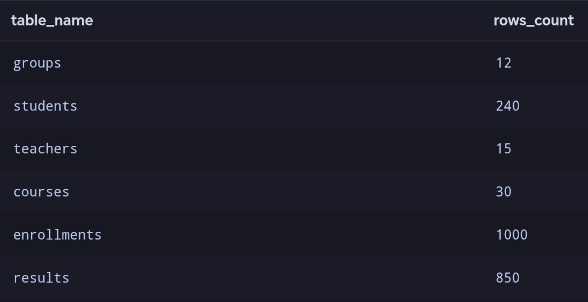

**Вывод:** все шесть таблиц доступны, всего 2147 записей.

## Шаг 2. Изучение структуры и формулирование аналитических запросов

База содержит шесть связанных таблиц:
| Таблица | Назначение | Основные поля | Записей |
|---|---|---|---:|
| `groups` | Группы | `id`, `group_name`, `study_year` | 12 |
| `students` | Студенты | `id`, `full_name`, `group_id`, `admission_year` | 240 |
| `teachers` | Учителя | `id`, `full_name`, `department` | 15 |
| `courses` | Курсы | `id`, `course_name`, `hourses`, `teacher_id` | 30 |
| `enrollments` | Зачисления | `id`, `student_id`, `course_id`, `enrolled_at`, `status` | 1000 |
| `results` | Результаты | `id`, `enrollment_id`, `score`, `completed_at` | 850 |

**Связи:** `students.group_id→groups.id`; `courses.teacher_id→teachers.id`; `enrollments.student_id→students.id`; `enrollments.course_id→courses.id`; `results.enrollment_id→enrollments.id`. В каждой таблице id — первичный ключ.

**Просмотр данных.** Просмотр первых пяти учеников.
```sql
SELECT * FROM students LIMIT 5;
```
**Результат:**
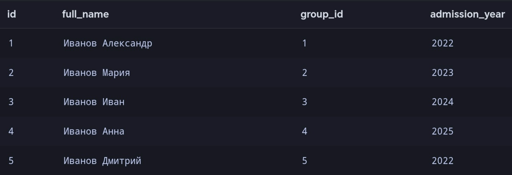

**Структура таблицы.** Просмотр полей и типов данных таблицы students.
```sql
PRAGMA table_info(students);
```
**Результат:**
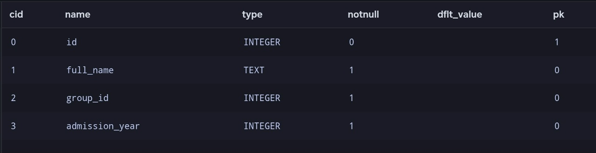

**Первичные и внешние ключи. Связи между таблицами.**

В базе данных используются первичные ключи (PRIMARY KEY) для идентификации записей и внешние ключи (FOREIGN KEY) для связи таблиц.
 - `groups.id` - первичный ключ группы.
 - `students.id` - первичный ключ студента.
 - `teachers.id` - первичный ключ учителя
 - `courses.id` - первичный ключ курса.
 - `enrollments.id` - первичный ключ зачисления.
 - `results.id` - первичный ключ результата.

**Связь между таблицами:**
 - `students.group_id→groups.id` - каждый студент связан с конкретной группой.
 - `courses.teacher_id→teachers.id` - каждый учитель связан с определенным курсом.
 - `enrollments.student_id→students.id` - каждый ученик связан с своим зачислением.
 - `enrollments.course_id→courses.id` - каждый курс связан с зачислением на этот курс.
 - `results.enrollment_id→enrollments.id` - каждое зачисление связано с результатами.

**Сформулированные аналитические вопросы:**
1. Какие курсы имеют больше всего итоговых оценок и какова их средняя оценка? (`courses`, `enrollments`, `results`)
2. Какие курсы наиболее популярны по количеству записей студентов? (`courses`, `enrollments`)
3. Какие учебный группы имеют наибольшее количество студентов? (`groups`, `stedents`)
4. Какие преподаватели ведут больше всего курсов и каковы результаты по этим курсам? (`teschers`, `courses`, `enrollments`, `results`)
5. Для каких курсов есть записи студентов, но пока нет итоговых результатов? (`courses`, `enrollments`, `results`)

## Шаг 3. Фильтрация и сортировка.

1. Вывод курсов продолжительностью не менее 60 часов. 
```sql
SELECT
    id,
    course_name,
    hours
FROM courses
WHERE hours >= 60
ORDER BY hours DESC, course_name ASC;
```
**Результат:**
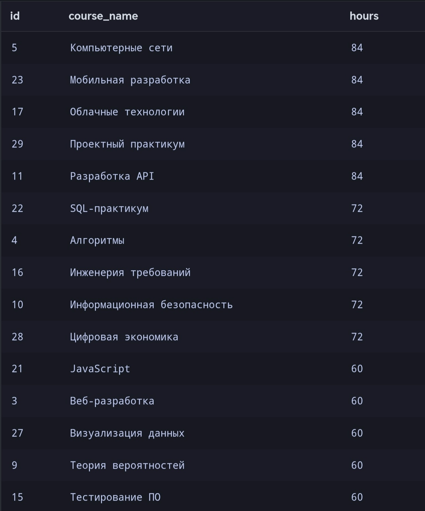

2. Список студентов, поступивших в 2025 году.
```sql
SELECT
    id,
    full_name,
    admission_year
FROM students
WHERE admission_year = 2025
ORDER BY full_name ASC
LIMIT 10;
```
**Результат:**
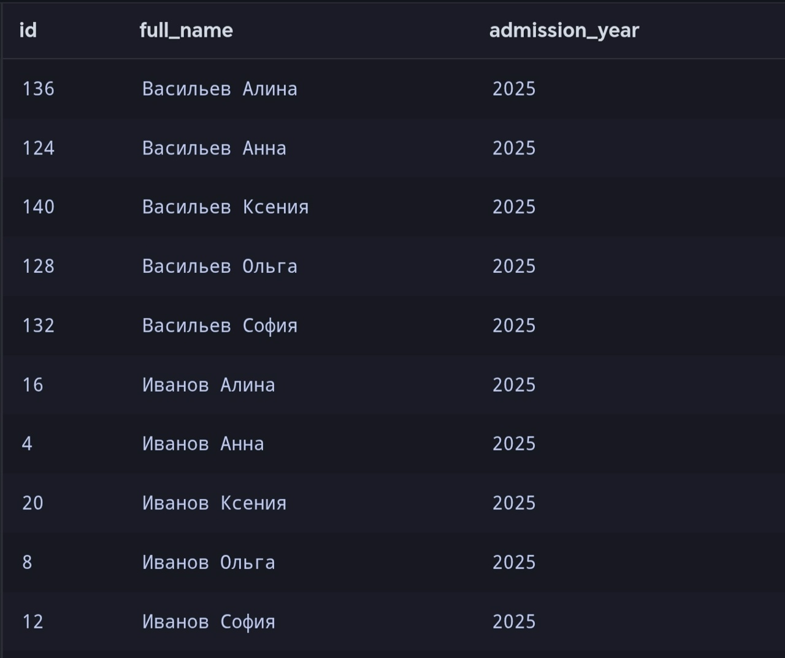

**Вывод:** `WHERE` отбирает нужные строки, `ORDER BY` сортирует, `LIMIT` ограничивает объём вывода.

## Шаг 4. Агрегирование и группировка.

1. Подсчет общего количества записей на курсы.
```sql
SELECT
    COUNT(*) AS total_enrollments
FROM enrollments;
```
**Результат:**
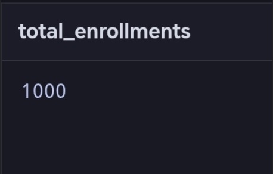

2. Расчет минимальной, максимальной и средней продолжительности курсов.
```sql
SELECT
    MIN(hours) AS min_hours,
    MAX(hours) AS max_hours,
    ROUND(AVG(hours), 2) AS avg_hours,
    SUM(hours) AS total_hours
FROM courses;
```
**Результат:**
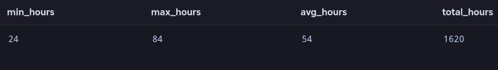

3. Подсчет количества записей по статусам.
```sql
SELECT
    status,
    COUNT(*) AS enrollments_count
FROM enrollments
GROUP BY status
HAVING COUNT(*) > 100
ORDER BY enrollments_count DESC;
```
**Результат:**
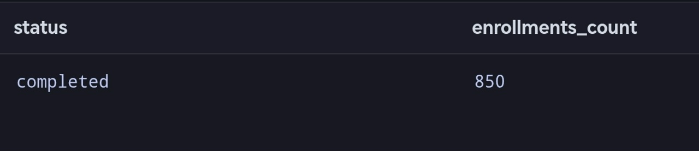

**Вывод:** с помощью `GROUP BY` были сгруппированы записи по статусам. Использование `HAVING` позволило отобрать только те группы, количество записей в которых превышает 100.

## Шаг 5. Объединение связанных таблиц.

1. Вывод списка 10 студентов и название групп, в которых они записаны.
```sql
SELECT
    s.id,
    s.full_name,
    g.group_name
FROM students AS s
INNER JOIN groups AS g
    ON g.id = s.group_id
ORDER BY s.id
LIMIT 10;
```
**Результат:**
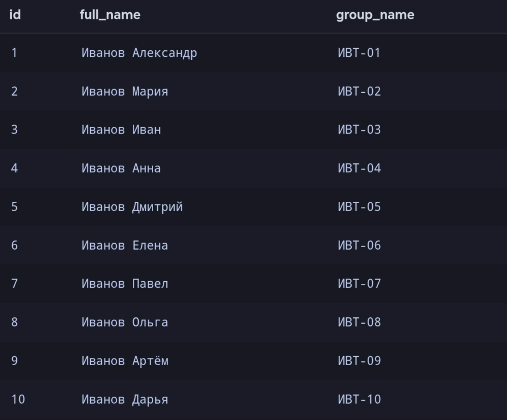

2. Вывести 10 курсов и ФИО преподавателей.
```sql
SELECT
    c.id,
    c.course_name,
    t.full_name
FROM courses AS c
INNER JOIN teachers AS t
    ON t.id = c.teacher_id
ORDER BY c.id
LIMIT 10;
```
**Результат:**
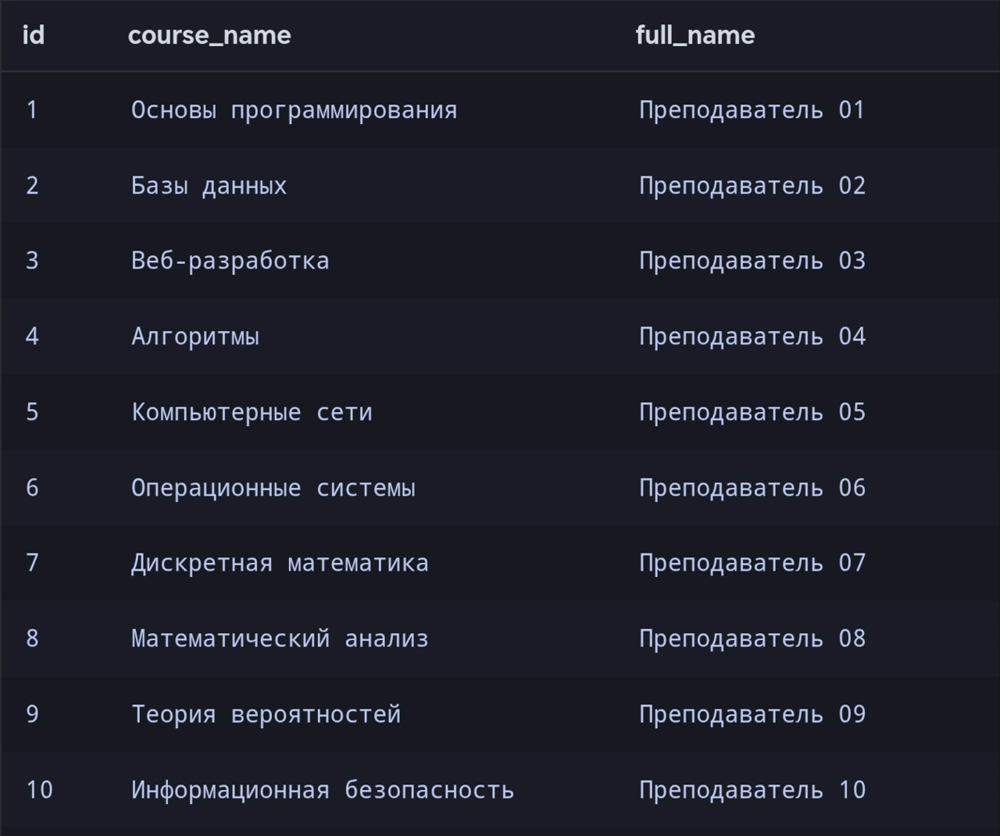

3. Вывести всех преподавателей и их курсы.
```sql
SELECT
    t.id,
    t.full_name,
    c.course_name
FROM teachers AS t
LEFT JOIN courses AS c
    ON t.id = c.teacher_id
ORDER BY t.id;
```
**Результат:**
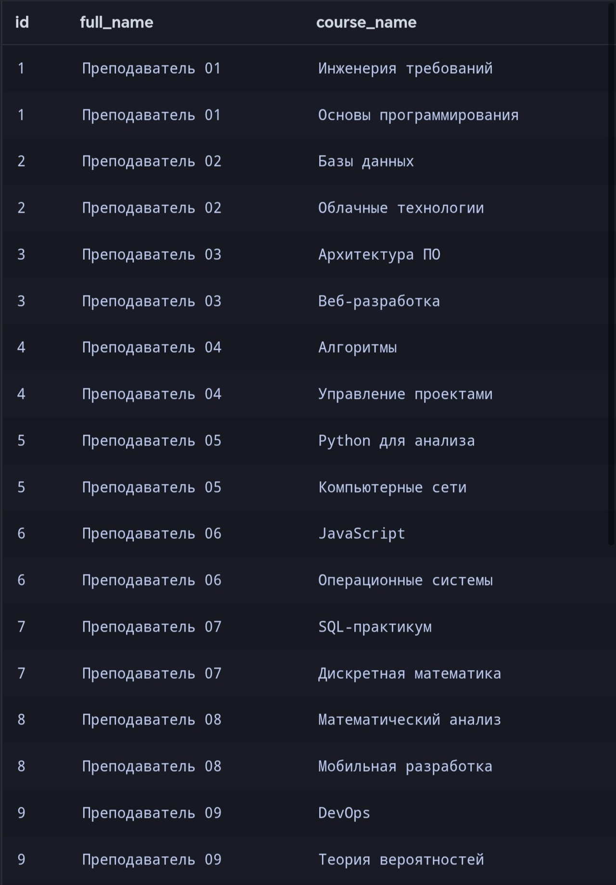

**Вывод:** `INNER JOIN` выводит только совпадающие записи, исключает строки без соответствия, используется для связанных данных. `LEFT JOIN` выводит все записи левой таблицы, сохраняет строки без соотетствия, используется для поиска всех записей.

## Шаг 6. Проверка корректности.

1. Проверить корректность оценок.
```sql
SELECT
    COUNT(*) AS invalid_scores
FROM results
WHERE score < 0
   OR score > 100
   OR score IS NULL;
```
**Результат:**


2. Проверка связей между таблицами.
```sql
SELECT
    COUNT(*) AS orphan_results
FROM results r
LEFT JOIN enrollments e
    ON r.enrollment_id = e.id
WHERE e.id IS NULL;
```
**Результат:**
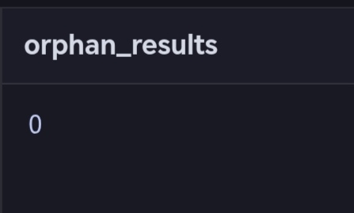

**Вывод:** оба запроса равны 0. В рамках проведённых проверок нарушений не обнаружено. Это не означает, что проверены абсолютно все возможные ошибки в данных.

## Шаг 7. Индивидуальное исследование и аналитические выводы

**Вариант 10.** Какие курсы имеют больше всего итоговых оценок и какова их средняя оценка?

Для выполнения спользуются три таблицы: `courses`, `enrollments`, `results`
Связи между таблицами: `enrollments.course_id→courses.id`, `results.enrollment_id→enrollments.id`
Для анализа показатели: `INNER JOIN`, `GROUP BY`, `COUNT`, `ORDER BY`, `ROUND`, `AVG`

**Подсчет количества итоговых оценок по всем курсам.**
```sql
SELECT
    c.course_name,
    COUNT(r.id) AS grade_count
FROM courses c
INNER JOIN enrollments e
    ON c.id = e.course_id
INNER JOIN results r
    ON e.id = r.enrollment_id
GROUP BY c.id, c.course_name
ORDER BY grade_count DESC;
```
**Результат:**
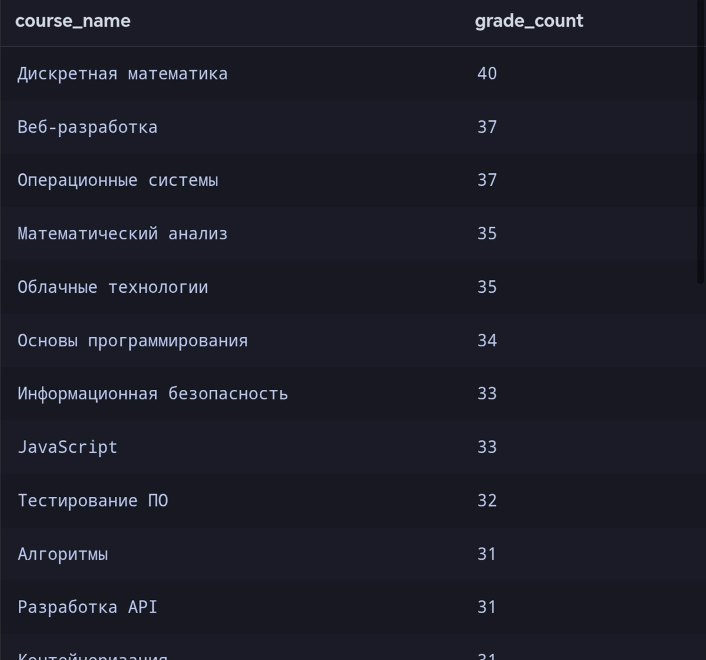

**Расчет средней оценки по каждому курсу.**
```sql
SELECT
    c.course_name,
    COUNT(r.id) AS grade_count,
    ROUND(AVG(r.score), 2) AS average_score
FROM courses c
INNER JOIN enrollments e
    ON c.id = e.course_id
INNER JOIN results r
    ON e.id = r.enrollment_id
GROUP BY c.id, c.course_name
ORDER BY grade_count DESC;
```
**Результат:**
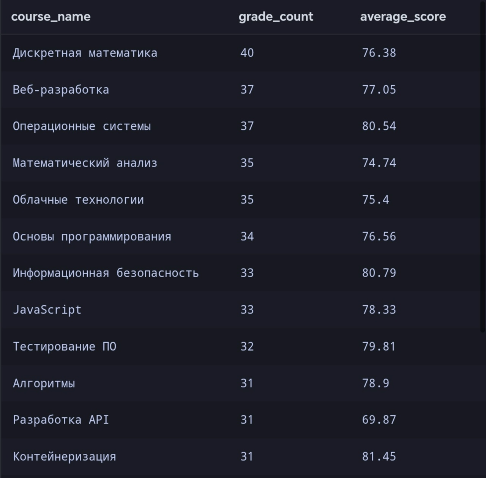

**Аналитические выводы:** 
1. Наибольшее количество итоговых оценок имеет курс "Диксретная математика".
2. Количество оценок по данному курсу составляет 40.
3. Средняя оценка на курсе равна 76.38.

## Итог

В работе изучена структура SQLite-базы из шести связанных таблиц, выполнены запросы с `WHERE`, `ORDER BY`, `LIMIT`, агрегатными функциями, `GROUP BY`, `HAVING`, `INNER JOIN`, `LEFT JOIN`; проведены проверки целостности и отдельное аналитическое исследование.

**Ограничение анализа:** анализ не учитывает сложность курса и индивидуальные особенности студентов.
